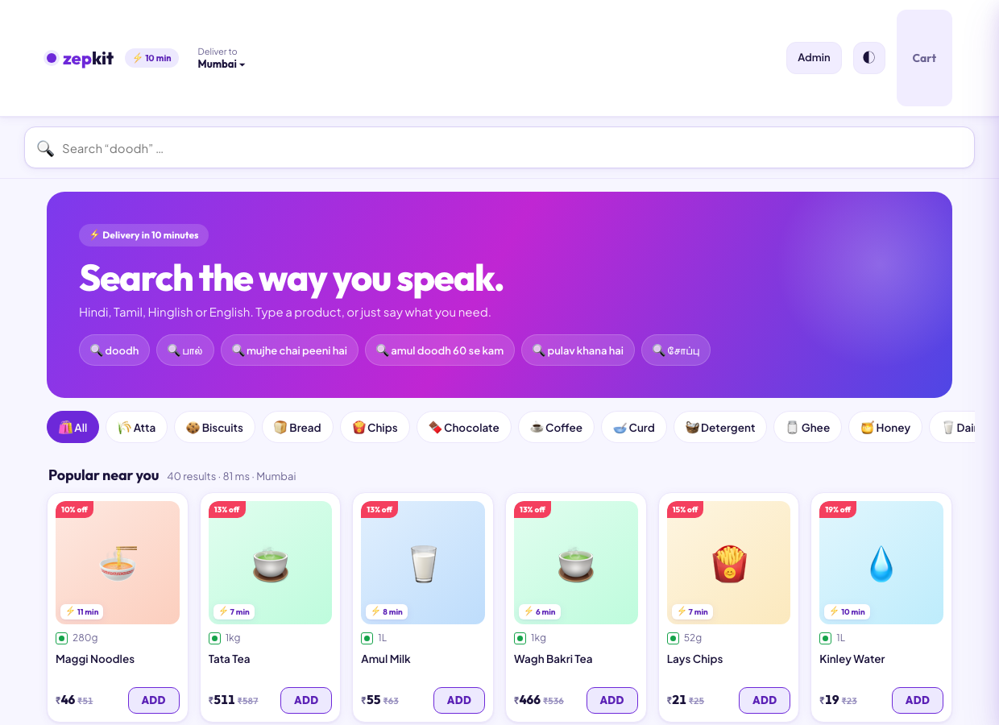
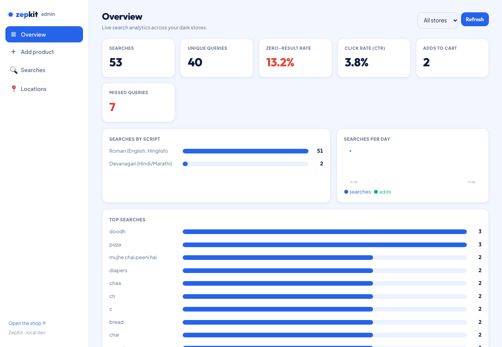
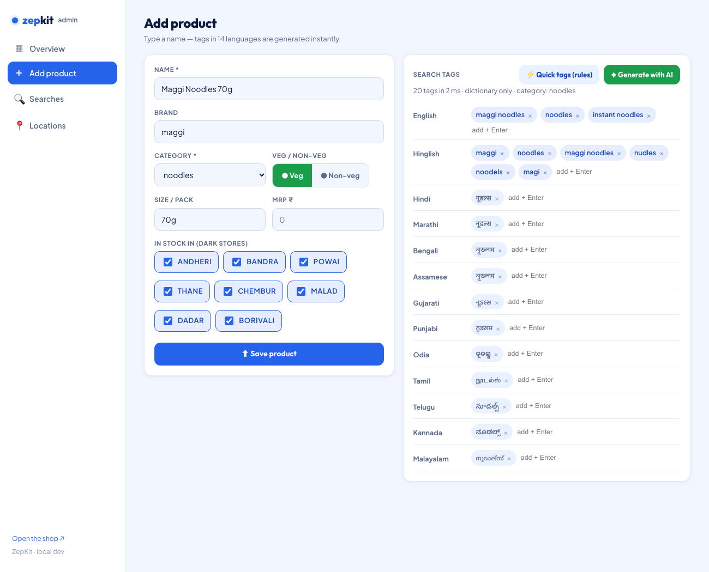

# ZepKit — Multilingual Semantic Search for Quick-Commerce

> A Blinkit/Zepto-style grocery app that lets shoppers **search the way they speak** — in Hindi, Tamil, Bengali, Hinglish, English, with typos, slang, and natural language — and finds the right product, scoped to their nearest dark store. Say "paneer butter masala banana hai" and get the ingredient list, ready to add to cart.

Search `potato`, `आलू`, `aloo`, `আলু`, `உருளைக்கிழங்கு`, or even `amul doodh 60 se kam` — all work. Tap the mic and speak in Hindi — voice-to-ingredients, just like Blinkit.

**35 product categories** (salt, milk, atta, rice, dal, cheese, pasta, paneer, nachos, soya sauce, and more) across 8 dark stores. Multilingual semantic retrieval, a 14-language tag pipeline, store-scoped hybrid ranking, recipe/intent detection, voice search, and a search-analytics loop.

---

## Screenshots

| Storefront | Admin · Analytics | Admin · Add product (14-language tags) |
|---|---|---|
|  |  |  |

---

## Why it's interesting

Plain keyword search breaks the moment the shopper and the catalog disagree on words. ZepKit searches on **meaning** (vector embeddings) **and** words (keyword + typo tolerance) together — **hybrid search** — and generates a wide **multilingual tag net** per product so exact matches work in any Indian language.

### Feature highlights
- **Multilingual** — one query in 14 languages finds the product (`bge-m3` embeddings + per-language tags/aliases).
- **Hybrid search** — TypeSense BM25 (keyword + typo tolerance) fused with vector k-NN.
- **Natural language** — `mujhe chai peeni hai` → tea; `amul doodh 60 se kam` → milk **under ₹60** (price parsed out of the query).
- **Voice search (Hindi/Hinglish)** — Blinkit-style full-screen mic overlay. Speak in Hindi, see live transcript, get instant results. Uses Browser Speech API (`hi-IN`, continuous mode, interim results) — zero backend, zero latency.
- **Recipe/intent detection** — say "paneer butter masala banana hai" and get a recipe card with 4 ingredients mapped to real products at your store, with "Add all to cart." Two-tier: instant KB dictionary (5 dishes) → Gemma 3 LLM fallback for novel dishes. Veg-only, fail-closed.
- **Hyperlocal** — catalog is global, stock/price is **per dark store**; search is scoped by pincode → store.
- **14-language tag generation** — rule-first dictionary (instant) + Gemma 3 LLM, moderated, grouped by language, editable.
- **Content safety** — `guardTags()` gate: fail-closed, veg/non-veg correctness, no slurs, clean repo.
- **Search analytics** — every search/click/add is logged; dashboard shows CTR, zero/missed rate, searches-by-script, per-day trends.
- **Demand loop** — a "missed" query (no good match) surfaces to the admin, who maps it to a product → it's added as an alias → re-indexed → found next time.
- **Admin RBAC** — admin page + mutations gated behind an `X-Admin-Key`.

---

## Architecture

```
   ADMIN (add product)                 USER (search / voice 🎤)
       │                          pincode → /locations/resolve
       │ POST /ai/tags/grouped             │ GET /search?q=aloo&store=S1
       │ POST /products                    │ (recipe detection: KB → LLM fallback)
       ▼                                   ▼
  ┌──────────────── API GATEWAY (Express) ─────────────────┐
  │  validate · produce          resolve · redis · embed · hybrid │
  └──────┬──────────────────────────────────────┬──────────────┘
         │ publish                               │ fast read (store-scoped)
         ▼                                       ▼
   KAFKA  products.ingest                    REDIS (hot cache)◄─┐
     │  → products.ingest.dlq (3 retries)         │ hit         │ miss
     ▼                                            ▼             │
  PRODUCT WORKER (single consumer group)       return      TYPESENSE
   • tags missing? → Gemma 3                                 hybrid
   • bge-m3 vector · guardTags() moderation                 keyword+vector
   • commit offset AFTER all 3 writes                        +store_ids
   ├────────────┬───────────────┬──────────┐
   ▼            ▼               ▼          ▼
 MongoDB     AI SERVICE     TypeSense    Redis
 (truth)     (Ollama)       (search)     (cache)
```

| Store | Role |
|-------|------|
| **MongoDB** | Single source of truth (catalog + per-store inventory + search logs). Everything else rebuilds from it. |
| **TypeSense** | Search engine — hybrid keyword + vector, typo tolerance, facets, store-scoped filter. |
| **Redis** | Hot cache — per-store stock/price, cached results & query vectors. |
| **Kafka** | Ingestion backbone — decouples the write API from the stores; replayable; DLQ. |
| **Ollama** | Local AI — `gemma3:4b` (tags) + `bge-m3` (1024-dim multilingual embeddings). |

**Stack:** Node.js + Express (ESM) · Apache Kafka (KRaft) · TypeSense · Redis · MongoDB · Ollama · vanilla-JS UIs. Monorepo via npm workspaces.

---

## How it works

**Write path.** `POST /products` assigns an `_id`, publishes `product.created` to Kafka, returns `202`. The worker enriches (tags + `bge-m3` vector + moderation), then **upserts** into Mongo, TypeSense (with `store_ids`), and Redis. The offset is committed only after all three succeed; 3 failures → DLQ. Idempotent upserts make retries safe.

**Read path.** `GET /search?q=&store=` checks Redis → **recipe detection** (KB dictionary for known dishes, Gemma 3 LLM fallback for novel dishes with Hinglish trigger phrases like "banana hai") → embeds the query (cached) → runs a TypeSense **hybrid** search (`query_by=title,tags,aliases` + `vector_query`) filtered by `store_ids`. If a recipe is detected, the response includes a `recipe` object with the dish name and ingredients resolved to real products. If no keyword matched **and** the nearest vector is far, it's flagged `missed` (a demand signal); otherwise close semantic matches are shown as "closest".

**Voice path.** The frontend uses the Browser Speech API (`hi-IN`, continuous mode) with a Blinkit-style full-screen overlay — speak naturally in Hindi/Hinglish, see a live transcript, and results appear when you stop. No backend needed — speech recognition runs entirely in the browser.

---

## Getting started

**Prereqs:** Docker, Node 20+, [Ollama](https://ollama.com).

```bash
# 1. models
ollama pull gemma3        # tags
ollama pull bge-m3        # multilingual embeddings

# 2. env + deps
cp .env.example .env
npm install

# 3. infra + bootstrap
npm run infra:up          # Kafka, TypeSense, Redis, MongoDB (docker compose)
node scripts/bootstrap.js # create Kafka topics + TypeSense collection

# 4. services (3 terminals)
npm run dev:ai            # AI service   :4001
npm run dev:api           # API gateway  :4000  (also serves the UI)
npm run dev:worker        # Kafka worker

# 5. seed 8 city stores + ~300 products (35 categories)
node scripts/seed.js
```

- **Shop** → http://localhost:4000
- **Admin** → http://localhost:4000/admin.html  (key: `zepkit-admin-2024`, change via `ADMIN_KEY`)

Try: `aloo`, `आलू`, `doodh`, `maggi`, `thanda`, `mujhe chai peeni hai`, `amul doodh 60 se kam`.

**Voice:** Tap 🎤 → speak "paneer butter masala banana hai" → see ingredients card → "Add all to cart."

**Recipe:** Type `pav bhaji banana hai` or `dal tadka bana hai` → instant ingredient breakdown.

---

## Tech decisions & tradeoffs

**Hybrid search (keyword + vector) in one engine.** Chose **TypeSense** over stitching Elasticsearch + a separate vector DB — it does BM25 + vector k-NN + typo tolerance in a single hop. Tradeoff: fewer heavy analytics/aggregations than Elasticsearch, and the index lives in RAM. For a search-first product at this scale, simplicity wins.

**Kafka as an ingestion buffer.** Decouples the write API from the three stores and lets each update independently + replay. Tradeoff: it's **heavier than this catalog strictly needs** — at low write volume a simple queue or direct writes would do. It's here to demonstrate an event-driven, fan-out ingestion design that scales to high write throughput and multiple consumers. Eventual consistency means a new product is searchable a few seconds after `202`.

**Local models via Ollama.** `bge-m3` is genuinely multilingual (the core of cross-language search); `gemma3:4b` generates tags. Tradeoff: LLM tag generation is slow on CPU (~5–10s) and a 4B model doesn't know every brand — so tags are **rule-first** (instant dictionary + transliteration) with the LLM as an optional enrich step.

**Rule-first tags + transliteration.** 14 languages come from a curated dictionary + Devanagari→script transliteration, not per-language LLM calls. Tradeoff: transliteration is phonetic, not translation (e.g., Marathi ≈ Hindi script) — good for search recall; [AI4Bharat IndicXlit](https://github.com/AI4Bharat/IndicXlit) is the accuracy upgrade path.

**Mongo = source of truth; everything else disposable.** `reindex` replays Mongo → TypeSense + Redis, so index/cache corruption is recoverable. Idempotent upserts + offset-after-write give at-least-once safety.

---

## What's next (roadmap)

- **Learning-to-rank** from the click/add events already logged (re-rank results by what shoppers actually pick).
- **Real transliteration** via AI4Bharat IndicXlit (replace phonetic mapping).
- **Query-as-you-type suggestions** from popular searches (not just product matches).
- **Faceted filters** in the UI (brand, price range, veg) — the facets already exist in the index.
- **Relevance tuning** — hybrid weight tuning + an optional cross-encoder re-rank stage.
- **Cross-lingual eval harness** — per-language precision@k on a labelled query set.
- **Brand dictionary** so the LLM path recognizes products it doesn't inherently know.
- **Observability** — Kafka lag, search latency histograms, DLQ alerts.

---

## Repo structure

```
zepkit/
├── docker-compose.yml          # Kafka · TypeSense · Redis · MongoDB
├── packages/common/            # shared config, event contracts, store clients
├── services/
│   ├── ai-service/             # Ollama wrapper: tags (14 langs) + embeddings + guardTags + recipe detection
│   ├── api-gateway/            # products · search · locations · analytics · RBAC · serves UI
│   └── worker/                 # Kafka consumer → Mongo / TypeSense / Redis + DLQ
├── infra/                      # TypeSense schema · Kafka topics
├── scripts/                    # bootstrap · seed · embedding checks
├── web/                        # shop (index.html + voice overlay) + admin (admin.html)
└── docs/                       # rules · content-safety · scoped · screenshots
```

---

Built as a focused demonstration of search engineering: multilingual retrieval, hybrid ranking, event-driven indexing, voice-to-ingredients, recipe intent detection, and a measurable search-quality feedback loop.
